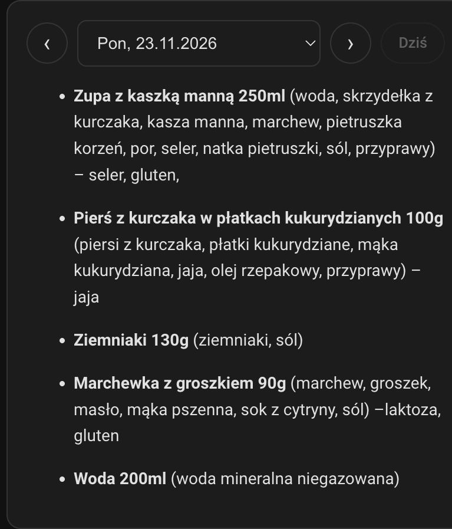

# EduPage Menu Calendar

Home Assistant custom integration for **public** EduPage school lunch menus (no login).

Last tested on Home Assistant **2026.11.1**. HACS requires **2023.8.0** or newer; older releases may work but are not verified.

[Polski](README.pl.md)

## Screenshot

Lovelace card `custom:edupage-menu-day` (day dropdown, optional arrows and **Today**):



## Install

### HACS (recommended)

1. [Install HACS](https://hacs.xyz/docs/setup/download) if needed.
2. Add this repository as a [custom repository](https://hacs.xyz/docs/faq/custom_repositories/) (category: **Integration**).
3. Install **EduPage Menu Calendar** from HACS → Integrations.
4. Restart Home Assistant.

[](https://my.home-assistant.io/redirect/hacs_repository/?owner=Flower7C3&repository=homeassistant-edupage-menu&category=integration)

### Manual

Copy the folder `custom_components/edupage_menu` into your Home Assistant `config/custom_components/` directory, then restart.

## Setup

**Settings → Devices & services → Add integration** → *EduPage Menu Calendar*.

Enter the public menu URL (EduPage **menu** page, e.g. `https://school.example/menu/`).

In integration options you can set the refresh interval, menu weeks (`weeks_range`, default `1-4`), weekday in titles, and behaviour of the “today” sensor.

## Lovelace card

The integration registers `custom:edupage-menu-day` (JS resource under `/edupage_menu/`).

```yaml
type: custom:edupage-menu-day
select_entity: select.edupage_menu_wybor_dnia
sensor_entity: sensor.edupage_menu_menu_wybrana_data
picker_arrows: true
picker_today: true
```

See `custom_components/edupage_menu/examples/lovelace_jadlospis_dnia.yaml`.

## Entities

| Entity | Role |
|--------|------|
| `select.*` | Day picker |
| `sensor.*` (selected date) | Menu for the picked day |
| `sensor.*` (today) | Today’s menu |
| `sensor.*` (next school day) | Next school day (weekend → Monday) |
| `calendar.*` | Calendar entries |

## License

[MIT](LICENSE)